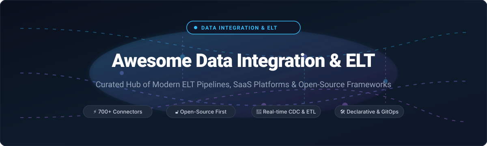

# 🚀 Awesome Data Integration & ELT 

### *A Curated Directory of Modern Data Ingestion, Streaming Pipelines, Cloud ELT/ETL SaaS & Open-Source Tooling*

  
  
  
  
  
  

**Last updated: October 2026** • *Connector Breadth, Pushdown Transformations, CDC Replication & Declarative GitOps Pipelines*

---

## 📖 Overview

This repository tracks notable **enterprise SaaS platforms** and **open-source frameworks** powering modern **Data Integration, ETL, and ELT**. These tools empower analytics and platform teams to extract structured and semi-structured data from transactional databases, cloud APIs, file lakes, and event streams; load high-throughput records into cloud data warehouses (Snowflake, BigQuery, Databricks, Redshift); and execute SQL/dbt transformations directly inside modern storage engines.

Key capabilities tracked include:
* 🔌 **Connector Breadth**: Pre-built integrations spanning SaaS REST APIs, change data capture (CDC) logs, and object storage.
* ⚡ **Real-Time Streaming & Replication**: Log-based replication using Debezium, Kafka, and low-latency transfer engines.
* 🛠 **Declarative Pipelines-as-Code**: Version-controlled, containerized pipelines orchestrated with GitOps and CI/CD.
* 💰 **Transparent Total Cost of Ownership (TCO)**: Deep dives into Monthly Active Rows (MAR), compute-hour models, and credit-based billing.

Contributions are welcome! Please review the [contributing guide](#-how-to-contribute) to add new tools.

---

## 📑 Table of Contents

- [📊 Sector Overview & Market Dynamics](#-sector-overview--market-dynamics)
- [☁️ SaaS & Hosted Platforms](#️-saas--hosted-platforms)
- [🔓 Open-Source GitHub Projects](#-open-source-github-projects)
- [🏗️ Recommended Architecture Stacks](#️-recommended-architecture-stacks)
- [🤝 How to Contribute](#-how-to-contribute)
- [💖 Support](#-support)
- [⭐ Star History](#-star-history)
- [⚠️ Disclaimer](#️-disclaimer)

---

## 📊 Sector Overview & Market Dynamics

The global data integration and ELT market is estimated between **$14.3 billion and $21.5 billion in 2026**, expanding at a ~12–14% CAGR toward over **$50 billion by the mid-2030s**. This accelerated growth is propelled by enterprise migration to hybrid lakehouse platforms, real-time analytics streaming, and enterprise AI preparation workflows that require continuous, clean contextual embeddings.

The sector demonstrates a **moderately concentrated tier at the top paired with a vibrant, fragmented long-tail**—decidedly **not** a single winner-take-all landscape:
1. **Cloud Hyperscalers & Legacy Incumbents**: AWS Glue, Google Cloud Dataflow, Informatica, and Qlik control massive enterprise and hybrid-cloud deployments governed by strict legacy compliance and high switching costs.
2. **Modern Managed ELT Disruptors**: Independent specialists like Fivetran and Matillion lead managed connector replication and pushdown data warehousing.
3. **Open-Source & GitOps Ecosystems**: Solutions such as Airbyte, Meltano, dlt, Debezium, and Kestra thrive because organizations resist proprietary vendor lock-in, demand transparent row costs, and insist on keeping sensitive data pipelines within their own security perimeter.

---

## ☁️ SaaS & Hosted Platforms

| Product | Company Size (Valuation / Revenue) | Pricing | Free Tier / Trial Limits | Description |
| :--- | :--- | :--- | :--- | :--- |
| **[Google Cloud Dataflow](https://cloud.google.com/dataflow)** | ~$4.2T Market Cap / ~$446B TTM Rev (Alphabet) | Pay-per-vCPU & memory ($0.056/vCPU-hr, $0.003557/GB-hr on US-Central1 batch); FlexRS offers up to 40% discount | **90-day free trial with $300 cloud credits** (capped at 8 concurrent worker vCPUs; no permanent Always-Free tier for Dataflow compute) | Fully managed stream and batch processing service based on Apache Beam. Auto-scaling worker infrastructure with Dataflow Shuffle and Streaming Engine. |
| **[AWS Glue](https://aws.amazon.com/glue/)** | ~$2.8T Market Cap / ~$776B TTM Rev (Amazon) | $0.44 per DPU-hour (1 DPU = 4 vCPU, 16 GB RAM; 1-min min for Glue 2.0+); Catalog $1/100K objects and $1/1M requests | **Always-Free tier**: 1M free metadata objects stored & 1M free catalog requests/month in AWS Glue Data Catalog (DPU compute for ETL jobs has no free tier and is billed from min 1) | Serverless Spark-based data preparation and ETL service with automatic schema discovery via crawlers and central Data Catalog. |
| **[Stitch (Talend)](https://www.stitchdata.com/)** | ~$10B Valuation / ~$1.5B ARR (Qlik) | Standard plan starts at **$100/month** (for 5M rows/month; scales to $1,500/mo for 100M rows and $3,000/mo for 1B rows) | **14-day free trial** with unlimited row replication and full connector access (plus 7-day initial grace period with unlimited rows for each new integration added) | Cloud-based ELT platform built on the Singer framework. Simple setup and broad connector catalog; now part of Qlik Talend Cloud. |
| **[Informatica](https://www.informatica.com/)** | ~$7.6B Market Cap / ~$1.68B TTM Rev (NYSE: INFA) | IPU consumption starting custom quotes (typical enterprise contracts start at tens of thousands/year; premium connectors $25k–$100k/yr) | **Always-Free tier**: 25 Informatica Processing Units (IPUs)/month on Cloud Data Integration (deleted if unused for 30 consecutive days); plus a **30-day full platform free trial** | Enterprise-grade cloud data integration, data management, and governance platform (IDMC) designed for complex regulatory compliance. |
| **[Fivetran](https://www.fivetran.com/)** | ~$5.6B Valuation / ~$300M+ ARR | Pay-as-you-go based on Monthly Active Rows (MAR) starting at **~$500/1M MAR**; minimum **$5/month per connection** (1–1M MAR); annual commits start at ~$12,000/yr | **Always-Free tier**: Up to **500,000 MAR/month**, 3,500 activation MAR, and 5,000 monthly transformation model runs (soft limit; upgraded/paused if exceeded 2 consecutive months) | Industry-standard managed ELT service offering 700+ automated pre-built connectors with automatic schema drift handling. |
| **[Airbyte](https://airbyte.com/)** | ~$1.5B Valuation / ~$20M+ ARR | Standard plan starts at **$20/month** (includes 5 credits; $5/credit thereafter; API sources: 6 credits/1M rows, DB/files: 4 credits/GB); Plus starts at **$189/month** (40 credits) | **30-day free trial with 400 credits**; open-source self-hosted version (Airbyte OSS) is permanently free | Highly customizable integration platform with 700+ connectors, CDK for custom connectors, and hybrid/cloud deployment models. |
| **[Matillion](https://www.matillion.com/)** | ~$1.5B Valuation / ~$75M–$100M ARR | Basic plans start at **$1,000–$3,000/month** based on Data Processing Units (DPU compute consumption model) | **14-day free trial with 500 platform credits** and unrestricted access across the Data Productivity Cloud | Cloud-native data transformation and integration platform focused on warehouse/lake pushdown transformations. |
| **[Hevo Data](https://hevodata.com/)** | ~$100M–$250M Valuation / ~$30M–$47M ARR | Starter plan starts at **$299/month** ($265/mo billed annually) for up to 5M events/month; Professional starts at **$849/month** | **Always-Free tier**: Up to **1,000,000 events/month** (with limited connectors and 5 user seats); plus a **14-day full-feature free trial** | No-code automated data pipeline platform with 150+ source connectors, automated schema management, and built-in reverse ETL. |
| **[Meltano](https://meltano.com/)** | Seed-stage ($12.4M raised) / GitLab spin-out | Meltano Cloud Starter plan pricing starts with custom quote based on compute hours (e.g. 200 compute-hr tier; pipelines charged by runtime not row volume) | **Open-source framework is 100% free indefinitely**; Meltano Cloud offers demo-based trial access upon request (typically 14 to 30 days upon sales consultation) | Developer-centric, GitOps-driven data integration framework built around Singer taps/targets and dbt pipelines-as-code orchestration. |

---

## 🔓 Open-Source GitHub Projects

Curated open-source projects for self-hosted data integration, CDC replication, pipelines-as-code, and workflow scheduling. **Sorted by GitHub stargazers count (descending)**:

1. **[n8n](https://github.com/n8n-io/n8n)**   
   **Fair-code workflow automation and pipeline integration tool** (Sustainable Use License) — Visual node-based pipeline orchestrator with 400+ native integrations. Widely adopted for multi-system API orchestration, webhook listeners, ETL event triggers, and data quality alerting.

2. **[Apache Airflow](https://github.com/apache/airflow)**   
   **The industry standard for programmatic workflow orchestration** (Apache-2.0) — Python-first DAG scheduler that coordinates massive extract, load, and transformation workflows across distributed compute backends and cloud warehouses.

3. **[Kestra](https://github.com/kestra-io/kestra)**   
   **Declarative, event-driven data orchestrator** (Apache-2.0) — YAML-defined, language-agnostic workflow orchestration unifying microservices, AI pipelines, and ELT jobs with built-in retry policies and real-time execution monitoring.

4. **[Prefect](https://github.com/prefecthq/prefect)**   
   **Modern Python workflow orchestration and pipeline management** (Apache-2.0) — Coordinates data pipelines with dynamic Python code, automatic retries, instant scheduling, state tracking, and cloud/hybrid execution agents.

5. **[Vector](https://github.com/vectordotdev/vector)**   
   **High-performance observability and stream data pipeline engine** (MPL-2.0) — Built in Rust for ultra-low latency log and metric ingestion, transformation, and routing at enterprise scale.

6. **[Airbyte OSS](https://github.com/airbytehq/airbyte)**   
   **Leading open-source data integration engine** (Elastic-2.0 for core) — Features 600+ connectors, UI/API orchestration, and a declarative Connector Development Kit (CDK) for building and maintaining custom database/API extractors.

7. **[Dagster](https://github.com/dagster-io/dagster)**   
   **Asset-based data orchestrator** (Apache-2.0) — Models data pipelines around data assets rather than tasks, with native awareness of software-defined assets, data lineage, partitioning, and automated sensor-driven triggers.

8. **[Logstash](https://github.com/elastic/logstash)**   
   **Server-side data processing pipeline engine** (SSPL/Elastic License) — Ingests data from multiple simultaneous sources, transforms it dynamically with filtering plugins, and delivers it to Elasticsearch and storage sinks.

9. **[dbt-core](https://github.com/dbt-labs/dbt-core)**   
   **The transform layer of modern ELT** (Apache-2.0) — Enables data engineers and analysts to transform data inside the warehouse using standard modular SQL, version control, automated testing, and compiled documentation.

10. **[Fluentd](https://github.com/fluent/fluentd)**   
    **Unified logging layer and event collector** (Apache-2.0 / CNCF Graduated) — Pluggable event stream collector connecting hundreds of application logging layers to warehouses, object stores, and search clusters.

11. **[Debezium](https://github.com/debezium/debezium)**   
    **Distributed Change Data Capture (CDC) platform** (Apache-2.0) — Streams row-level database changes from PostgreSQL, MySQL, SQL Server, and Oracle into Apache Kafka, Iceberg, and streaming sinks with millisecond latency.

12. **[Apache SeaTunnel](https://github.com/apache/seatunnel)**   
    **High-performance, distributed, massive data integration tool** (Apache-2.0) — Synchronizes billions of daily records across 100+ connectors with batch/stream unification, connector isolation, and zero-data-loss checkpointing.

13. **[Redpanda Connect](https://github.com/redpanda-data/connect)**   
    **High-performance stream processor and data pipeline router** (Apache-2.0, formerly Benthos) — Declarative, memory-efficient streaming engine supporting stateless data transforms, message brokers, and enterprise connectors.

14. **[CloudQuery](https://github.com/cloudquery/cloudquery)**   
    **High-performance ELT framework for cloud infrastructure and SaaS APIs** (MPL-2.0) — Extracts cloud assets, configurations, and API data into PostgreSQL, BigQuery, Snowflake, and ClickHouse for security and compliance audits.

15. **[Apache Hudi](https://github.com/apache/hudi)**   
    **Streaming data lake platform** (Apache-2.0) — Provides table-level transactional storage with CDC ingestion, upserts, incremental queries, and compaction on cloud object storage.

16. **[Apache NiFi](https://github.com/apache/nifi)**   
    **Flow-based visual data management and distribution platform** (Apache-2.0) — Highly configurable drag-and-drop pipeline interface with real-time bidirectional data flow control, prioritization, and complete data provenance tracking.

17. **[dlt (data load tool)](https://github.com/dlt-hub/dlt)**   
    **Lightweight Python library for automated data loading** (Apache-2.0) — Developer-first data pipeline library that automatically infers schemas, flattens nested JSON structures, manages migrations, and loads records directly into warehouses and vector databases.

18. **[Meltano](https://github.com/meltano/meltano)**   
    **Declarative, code-first DataOps and ELT framework** (MIT) — Built on the Singer open specification. Manages 600+ taps and targets as code via `meltano.yml`, bundling extractors, loaders, dbt transforms, and pipeline testing directly in version control.

19. **[Apache Gobblin](https://github.com/apache/gobblin)**   
    **Distributed data integration framework** (Apache-2.0) — Enterprise ingestion engine developed by LinkedIn for streaming and batch data ecosystem integration across big data storage layers.

20. **[Bruin](https://github.com/bruin-data/bruin)**   
    **CLI-driven end-to-end data pipeline tool** (Apache-2.0) — Combines SQL and Python transformations with built-in asset dependencies, lineage graph generation, quality checks, and schema validation.

21. **[Singer Specification](https://github.com/singer-io/getting-started)**   
    **Open specification for modular data extractors and loaders** (Apache-2.0) — Defines UNIX-style communication between JSON-emitting taps and stdin-consuming targets; forms the architectural foundation for Meltano and Stitch.

22. **[Sling CLI](https://github.com/slingdata-io/sling-cli)**   
    **High-speed CLI data movement tool** (MIT) — Fast database-to-database, file-to-database, and cloud storage replication engine that transfers data with minimal configuration and zero external dependencies.

23. **[Conduit](https://github.com/conduitio/conduit)**   
    **Real-time data integration streaming tool written in Go** (Apache-2.0) — Lightweight, single-binary data streaming engine designed for zero-dependency local or Kubernetes-native low-latency CDC pipelines.

---

## 🏗️ Recommended Architecture Stacks

Depending on your team size and infrastructure governance model, modern data teams typically compose these open and managed tools into cohesive stacks:

* **The Code-First / GitOps Stack**:
  `Meltano` or `dlt` (Ingestion) + `dbt Core` (Transformation) + `Dagster` or `Apache Airflow` (Orchestration) + `Snowflake / ClickHouse / DuckDB` (Engine).
* **The High-Scale Real-Time CDC Stack**:
  `Debezium` or `Redpanda Connect` (Change Capture) + `Apache Kafka` (Stream Buffer) + `Apache Hudi / Apache SeaTunnel` (Lakehouse Ingestion).
* **The Zero-Maintenance Cloud Stack**:
  `Fivetran` or `Airbyte Cloud` (Automated Connectors) + `dbt Cloud` (Transformation) + `BigQuery / Databricks` (Managed Analytics).

---

## 🤝 How to Contribute

Contributions are welcome and highly appreciated! To submit a new tool or suggest improvements:

1. 🍴 **Fork the repository** on GitHub.
2. 🌿 **Create a new branch** (`git checkout -b feature/add-new-tool`).
3. 📝 **Add or edit the entry** in `README.md` following the existing format:
   - Include official website or GitHub repo link.
   - For SaaS tools: provide pricing model, starting tier price, and free tier/trial limits.
   - For open-source tools: include GitHub stargazers badge linking to the `/stargazers` page.
4. 🚀 **Commit your changes** (`git commit -m "Add ToolName: brief description"`).
5. 📤 **Push to your fork** and submit a **Pull Request**.

---

## 💖 Support

If you find this curated data integration directory helpful, consider supporting the project:

* ⭐ **Star this repository** to help others discover it!
* 🍴 **Fork the project** and share your favorite integration blueprints.
* ☕ **Buy me a coffee / sponsor ongoing maintenance**: [Sponsor Dashboard on GitHub Sponsors](https://github.com/sponsors/ishandutta2007)

Your support keeps this directory independent, accurate, and up-to-date!

---

## ⭐ Star History

---

## ⚠️ Disclaimer

- This repository is a **community-curated index** for informational and educational purposes. Inclusion does not constitute an official endorsement.
- All enterprise data integration workloads must adhere to regulatory compliance mandates (GDPR, HIPAA, SOC 2, CCPA) with granular access control and audit trails.
- Pricing, API connector support, and free tiers change frequently. Always consult official vendor documentation for up-to-date commercial pricing terms.

---

**Built with ❤️ for data engineers, analytics architects, and infrastructure teams worldwide.**

